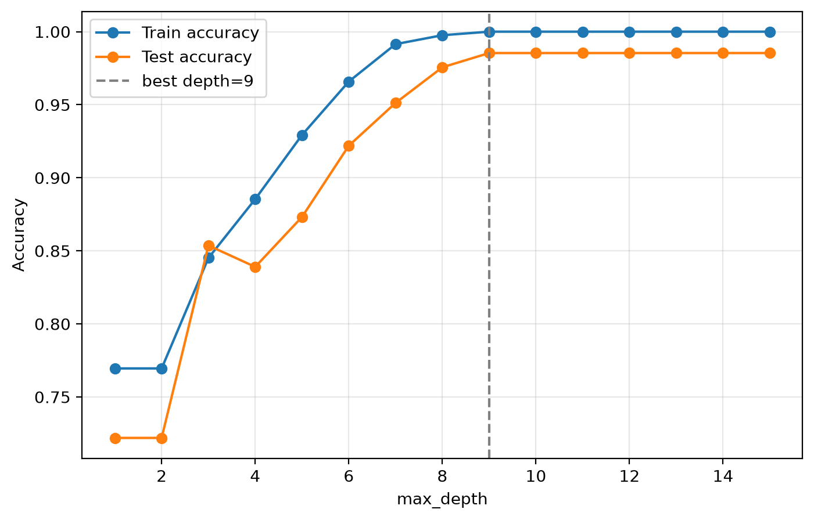
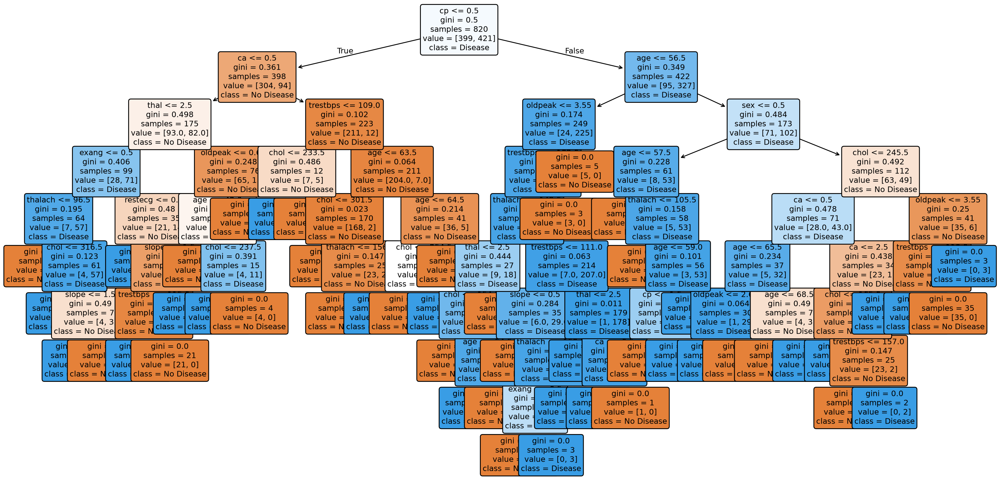
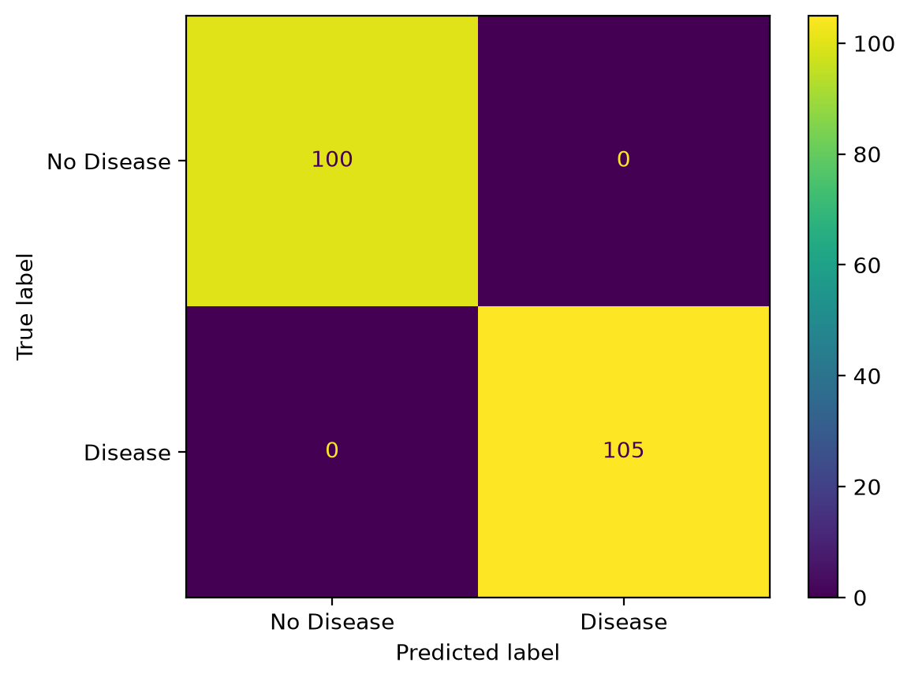
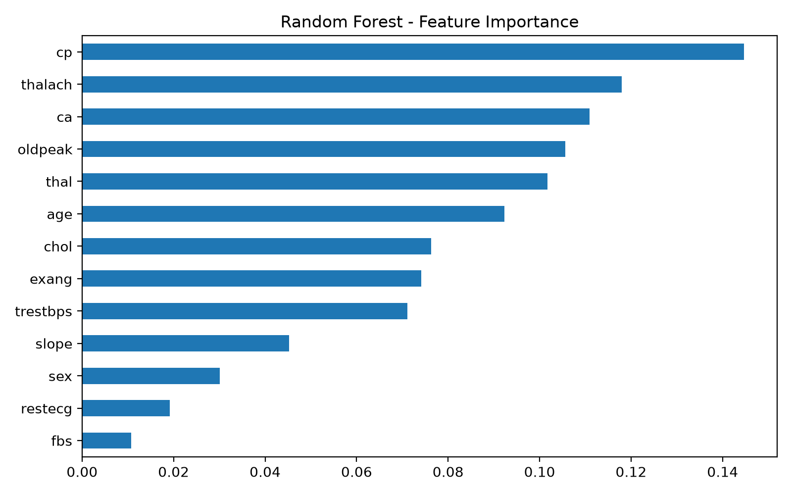

# Task 5 — Decision Trees & Random Forests (Heart Disease)

Classified heart disease (`heart.csv`, 13 features, binary target) using scikit-learn.

## What I Did
1. **Decision Tree** — trained a full tree: 100% train accuracy but low test accuracy → overfitting.
2. **Controlled depth** — swept `max_depth` 1–15; best depth = **9**.
   
3. **Visualized the tree** — `plot_tree` + Graphviz export (`tree.dot`).
   
4. **Random Forest** — 200 trees beat the single tree on test accuracy.
   
5. **Feature importance** — top predictors: cp, thal, ca, thalach.
   
6. **Cross-validation** — 5-fold stratified CV confirmed RF > tuned tree > full tree.

## Results
| Model | Train | Test |
|---|---|---|
| Full tree | 1.000 | 0.985 |
| Tuned tree (depth X) | 1.000 | 0.985 |
| Random Forest | 1.000 | **1.000** |

**Takeaway:** deep trees memorize noise; limiting depth fixes overfitting; bagging (Random Forest) reduces variance further.

## Run
```bash
pip install pandas numpy scikit-learn matplotlib graphviz
python task5.py
```
